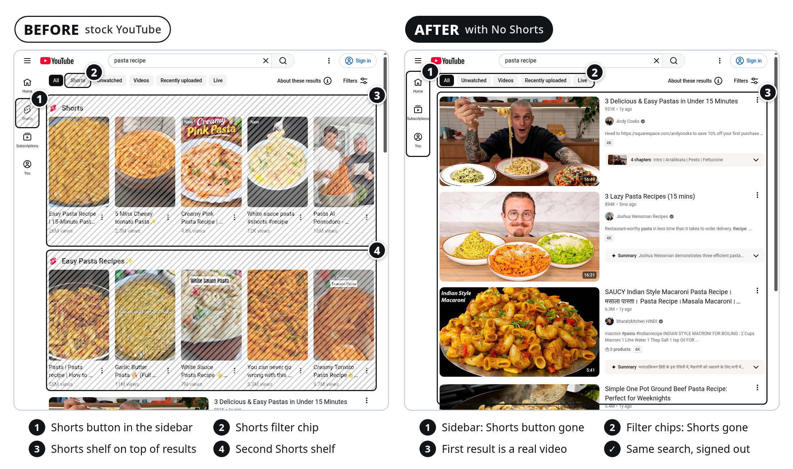

# No Shorts

**YouTube without Shorts.** You open YouTube for one video, you watch that video, you close the tab.

Same search, taken minutes apart on 2026-11-26 in two fresh Brave profiles, signed out. Left: no extension. Right: No Shorts loaded. Nothing else differs.

## What changes for you

- **Search gives you videos.** The first thing under the search box is a real result, not two rows of Shorts.
- **Nothing to tap "just once".** The Shorts button is gone from the sidebar, the Shorts tab is gone from channels, the Shorts chip is gone from the filters.
- **Your feeds are only regular videos.** Home, subscriptions, the watch-page sidebar and notifications stop mixing in Shorts.
- **A Shorts link is just a video.** When someone sends you one, it opens in the normal player: seek bar, speed control, and no next clip waiting under your thumb.
- **Same on your phone's browser.** `m.youtube.com` gets the same treatment.
- **You stay in charge.** One switch in the toolbar turns it off and on again, instantly, without reloading the page.

It does this without knowing anything about you: no account, no tracking, no remote code, no network requests.

## Install

There is no store listing yet, so you load the folder yourself. It takes a minute.

**Chrome / Brave / Edge**
1. Download or clone this repo.
2. Open `chrome://extensions` (Brave: `brave://extensions`) and turn on **Developer mode**.
3. Click **Load unpacked** and pick the repo folder.

**Firefox** (128+)
1. Open `about:debugging#/runtime/this-firefox`.
2. Click **Load Temporary Add-on…** and pick `manifest.json`.
   Temporary add-ons are removed when Firefox restarts. For a permanent install the extension has to be signed through addons.mozilla.org.

## Privacy

| It asks for | Why |
|---|---|
| Access to `youtube.com`, `www.youtube.com`, `m.youtube.com` | To hide Shorts on those pages. It runs nowhere else. |
| `storage` | To remember the two switches in the popup. |
| `declarativeNetRequest` | For one fixed rule that turns `/shorts/<id>` into `/watch?v=<id>`. |

Nothing is collected and nothing leaves your browser. The whole extension is about 260 lines; you can read it in ten minutes.

## How it works

| Part | File | Job |
|---|---|---|
| CSS rules | [`content/hide.css`](content/hide.css) | Hides everything Shorts-related. Injected at `document_start`, so nothing flashes. All rules are scoped to `html[data-disable-shorts]`, so the toggle just flips that attribute. |
| Content script | [`content/content.js`](content/content.js) | Sets the attribute, catches clicks on Shorts links and YouTube's in-app navigations, and has a fallback that hides shelves whose heading is literally "Shorts" (for when YouTube ships new markup). |
| Redirect rule | [`rules/redirect.json`](rules/redirect.json) | `declarativeNetRequest` rule that turns `/shorts/<id>` page loads into `/watch?v=<id>` before the page even loads. |
| Popup | [`popup/`](popup) | The two switches. Settings are kept in `storage.sync`. |

Selectors are matched on stable things where possible (`href^="/shorts/"`, `is-shorts`, Shorts-specific element names) instead of translated text, so it works with any YouTube language. Checked against live YouTube (desktop and mobile, German UI) on 2026-11-25.

## When YouTube changes something

YouTube renames its elements every few months. If Shorts show up again:

- **Report it:** open an issue with the [Shorts are showing](../../issues/new?template=shorts-showing.yml) template.
- **Or fix it:** open DevTools on the leftover element, find the nearest `ytd-…`/`ytm-…`/`…-view-model` wrapper, and add it to `content/hide.css`. [CONTRIBUTING.md](CONTRIBUTING.md) has the details.

## Contributing

Bug reports and one-line selector fixes are very welcome. See [CONTRIBUTING.md](CONTRIBUTING.md) and the [Code of Conduct](CODE_OF_CONDUCT.md). Security problems go through [SECURITY.md](SECURITY.md).

## License

[MIT](LICENSE)

This project is not affiliated with, endorsed by, or sponsored by YouTube or Google. "YouTube" and "YouTube Shorts" are trademarks of Google LLC.
